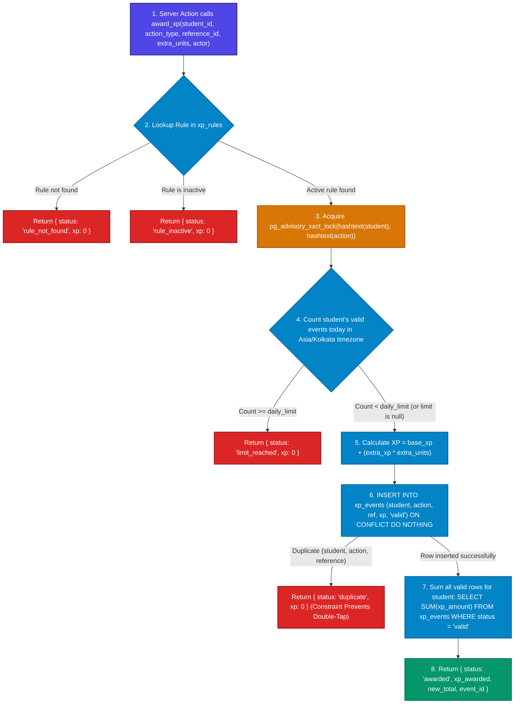

# ⚡ The XP Flow Architecture (`award_xp`)

> **Golden Rule:** Every XP point is an immutable ledger entry. Total XP is strictly calculated as `SUM(xp_amount)` of valid entries. No code path may write XP other than `award_xp`.

---

## 🧭 Visual Flowchart

---

## 📝 Step-by-Step Plain English Explanation

1. **Server-Side Invocation:** The trusted server action verifies the caller's credentials (faculty or admin) and executes `award_xp` via the service role key; direct client calls are blocked with permission denied.
2. **Rule Verification:** The database looks up the action in `xp_rules` to ensure the rule exists and is currently active.
3. **Advisory Lock Serialization:** A transaction-level advisory lock serializes concurrent requests for this student and action, guaranteeing that two simultaneous double-taps cannot slip past the daily limit.
4. **Timezone Calendar Limit Check:** The database evaluates the current calendar day at midnight in `Asia/Kolkata` time and counts prior valid events to enforce the configured daily cap.
5. **Point Calculation:** Points are computed dynamically from the database rule formula: `base_xp + (extra_xp * extra_units)`.
6. **Ledger Insert:** The event is written into the immutable `xp_events` ledger table with `status = 'valid'`.
7. **Constraint Protection:** If the exact same `(student_id, action_type, reference_id)` already exists, `ON CONFLICT DO NOTHING` prevents duplicate payouts and returns `duplicate` without crashing.
8. **Total XP Computation:** The student's new total is recalculated on the fly from the sum of all valid ledger rows and returned in the JSON payload.
